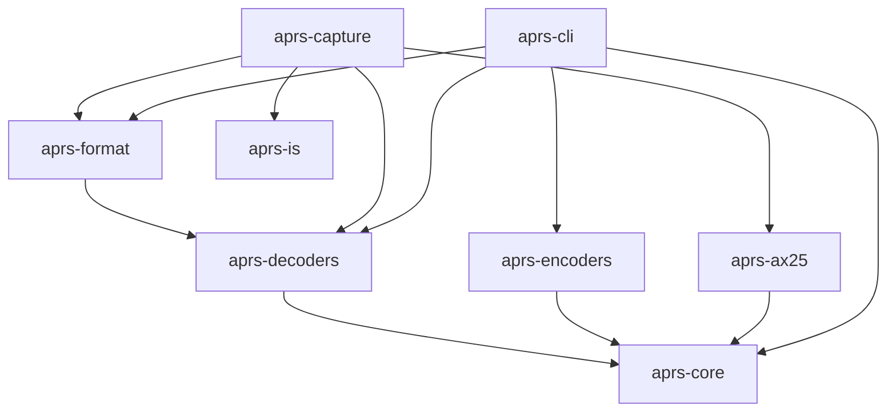
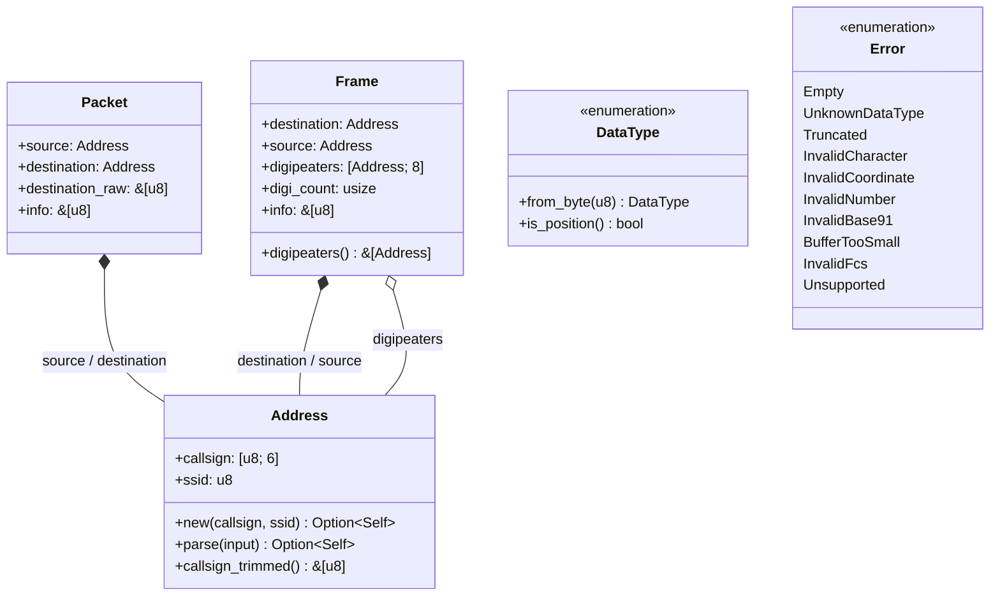
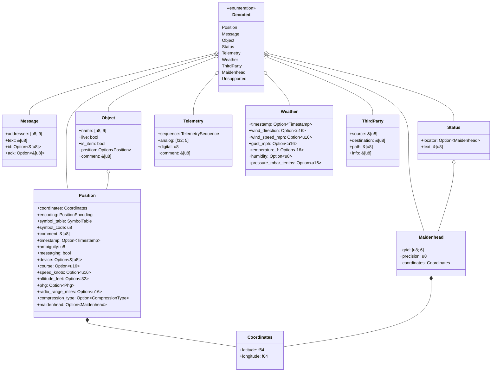

# RustAPRS

A modular APRS (Automatic Packet Reporting System) protocol engine in Rust,
targeting embedded systems (STM32-class MCUs) with host-side decode testing
against APRS-IS bulk data.

Conforms to the **APRS Protocol Reference 1.2** (draft "1.2c", November 2024),
**AX.25 2.2**, and the **KISS** host-to-TNC protocol. The reference documents
live at the repo root as `APRS12c.txt`, `ax25.txt`, and `kiss.txt`.

## Workspace layout

| Crate | Purpose | `no_std` |
|-------|---------|----------|
| `aprs-core` | Data model, strict AX.25 addressing, data-type detection, base-91 (encode + decode), errors, TNC2 parser | ✅ |
| `aprs-decoders` | Payload decoders (all data types) | ✅ |
| `aprs-encoders` | Payload encoders (all data types) | ✅ |
| `aprs-ax25` | AX.25 frame layer (FCS/CRC, address encoding) + KISS framing | ✅ |
| `aprs-is` | APRS-IS client (async) | ❌ |
| `aprs-format` | Human-readable formatting for decoded packets | ❌ |
| `aprs-capture` | CLI corpus collector (APRS-IS + serial KISS TNC) | ❌ |
| `aprs-cli` | Human-friendly decode / encode CLI | ❌ |

## Architecture

### Workspace crate dependencies



The four `no_std` crates (`aprs-core`, `aprs-decoders`, `aprs-encoders`,
`aprs-ax25`) depend only on `core`. The host-side crates add `std`/`tokio`/`clap`:
`aprs-is` uses `tokio` for its async client, `aprs-format` renders decoded values
for the CLIs, and the two binaries (`aprs-capture`, `aprs-cli`) tie the pieces
together.

### Core primitives and AX.25 transport



`Packet` is the transport-independent view of a frame (TNC2, AX.25, or KISS);
`Frame` is the AX.25 wire form. `aprs-ax25` layers FCS (`fcs`, `fcs_valid`) and
KISS framing (`encode`, `decode`, `decode_payload`) on top of these as free
functions.

### Decoded data model



`Decoded` is the sum type returned by `decode` / `decode_packet`; each variant
wraps the corresponding struct. `Position` is the richest payload — it carries
compression/ambiguity/timestamp metadata alongside the coordinate, and for
Mic-E additionally the messaging capability and device identifier suffix.

## Design goals

- **Bidirectional codec**: pure, allocation-free functions. Decoders are
  `&[u8] -> Result<_, Error>`; encoders write into a caller-provided buffer and
  return the number of bytes written.
- **Zero-dependency core**: `aprs-core`, `aprs-decoders`, `aprs-encoders`, and
  `aprs-ax25` depend only on `core`, so they compile for any `no_std` target.
- **AX.25 + KISS transport**: `aprs-ax25` assembles/disassembles AX.25 UI frames
  (FCS, addressing) and provides KISS framing (`encode`/`decode`) for host↔TNC
  links, including the `FF Return` command used to exit KISS mode.
- **Strict RF/AX.25 addressing**: addresses are a 6-character callsign plus a
  4-bit SSID (0–15). APRS-IS-only identifiers (alphanumeric SSIDs, 7+ character
  callsigns, gateway prefixes) are rejected; on the air they travel via
  third-party (`}`) encapsulation instead.
- **Corpus-driven testing**: real TNC2 monitor-format lines (as delivered by
  APRS-IS) drive unit tests and regression suites, with encode→decode round-trip
  tests for every encoder.

## Status

- [x] `aprs-core` — data model, strict addressing, base-91, TNC2
- [x] `aprs-decoders` — every v1 data type
- [x] `aprs-encoders` — every v1 data type
- [x] `aprs-ax25` — FCS + addressing + KISS
- [x] `aprs-is` — async APRS-IS client
- [x] `aprs-format` — human-readable decoded output
- [x] `aprs-capture` — corpus collector (APRS-IS + serial KISS TNC)
- [x] `aprs-cli` — decode / audit / encode

### Decode coverage

- **Positions**: uncompressed, base-91 compressed, and Mic-E — including
  position ambiguity, course/speed/altitude, radio range, `PHG`/`RNG`/`CSE-SPD`
  data extensions, compression `T` byte, and Maidenhead locators.
- **Objects / Items** (`;`/`)`), **Messages** (`:`), **Status** (`>`),
  **Telemetry** (`T#`), **Weather** (`_` and complete reports).
- **Third-party** (`}`) traffic, including Mic-E payloads inside the
  encapsulated packet.
- **Maidenhead grid locators** (`[` beacon, Mic-E status text, status reports).

### Encode coverage

Uncompressed/compressed/Mic-E positions, messages, objects/items, status,
telemetry, and positionless weather — each with a round-trip test against the
decoder.

## Usage

Decode a packet or a stream of TNC2 lines:

```sh
cargo run -p aprs-cli -- decode "N0CALL-9>APRS,WIDE1-1,WIDE2-1:!4903.50N/07201.75W-Test"
# ...or pipe a corpus file:
cargo run -p aprs-cli -- decode < corpus/sample.tnc2
```

Encode a position report (note `--lon=-72.02` for negative values):

```sh
cargo run -p aprs-cli -- encode --lat 49.0583 --lon=-72.0292 --symbol /- --comment "Test"
# N0CALL>APRS:!4903.50N/07201.75W-Test
```

Audit a captured corpus and report decode statistics:

```sh
cargo run -p aprs-cli -- audit corpus/raw --examples 10
```

Collect bulk traffic from APRS-IS (requires a valid callsign/passcode):

```sh
cargo run -p aprs-capture -- --callsign N0CALL --center 43.65 -79.38 --radius 500 --max-packets 100000
```

`--center LAT LON` + `--radius KM` build a radial range filter (`r/lat/lon/dist`),
sent as part of the login line; use `--filter '...'` for an arbitrary APRS-IS
filter string instead.

Collect from a serial KISS TNC (e.g. a Kantronics unit) instead of APRS-IS:

```sh
# TNC already in KISS mode:
cargo run -p aprs-capture -- --serial /dev/ttyUSB0 --baud 19200

# Have the app put the TNC into KISS mode first, and return it to normal
# (terminal) mode on exit:
cargo run -p aprs-capture -- --serial /dev/ttyUSB0 --baud 19200 --init-kiss
```

With `--init-kiss`, the app sends the Kantronics `INTFACE KISS\r` command on
start, and on clean exit (Ctrl-C / SIGTERM) sends the KISS `FF Return` command
(`FEND 0xFF FEND`) to hand the TNC back to its normal command interpreter.

## Development

```sh
cargo test --workspace                       # unit + round-trip + corpus tests
cargo clippy --workspace --all-targets       # keep clean
# Verify the no_std crates compile for an embedded target:
cargo check -p aprs-core -p aprs-decoders -p aprs-encoders -p aprs-ax25 \
    --target thumbv7em-none-eabihf
```

## License

MIT
